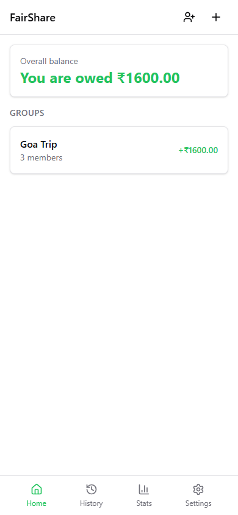
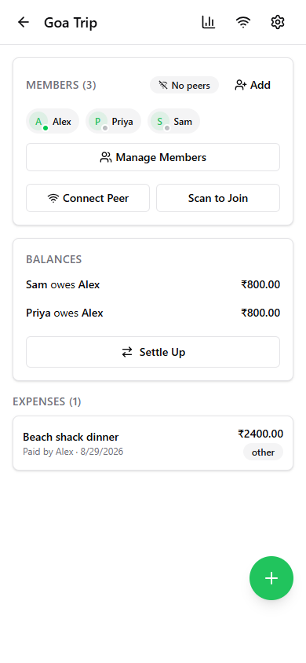
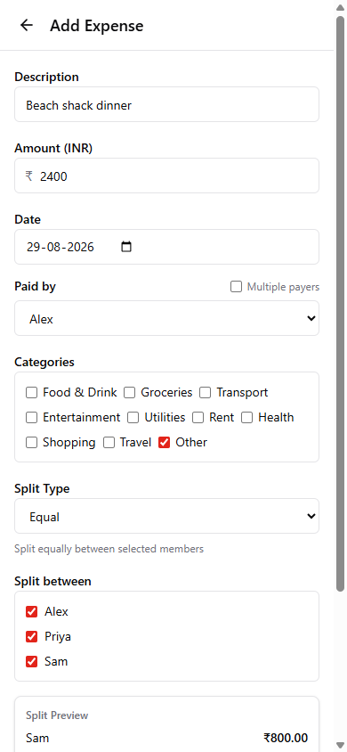
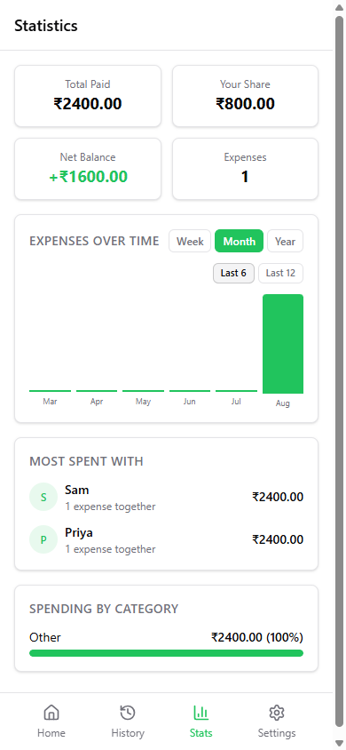

# FairShare


A serverless, peer-to-peer expense splitting PWA. No accounts, no cloud: just direct device-to-device sync via WebRTC.

Split bills with roommates, trips, or any shared costs. Every device keeps its own local copy
of each group (IndexedDB) and syncs directly with other devices over WebRTC when they're both
online. There's no backend, no login, and nothing ever leaves your devices except what you
sync peer-to-peer. It runs as a regular web app/PWA, and also ships as a native Android/iOS app
via Capacitor.

<p>
  
  
  
  
</p>

## Quick Start

```bash
npm install
npm run dev
```

Open `http://localhost:5173` in your browser.

## Build

```bash
npm run build    # TypeScript check + production build
npm run preview  # Serve the production build locally
```

## Test

```bash
npm test         # Run Vitest
```

## Native builds (Android / iOS)

This is also a native Android/iOS app via [Capacitor](https://capacitorjs.com) - the `android/`
and `ios/` folders are full native projects, not just config.

```bash
npm run cap:build          # web build + cap sync
npm run cap:android        # open the Android project in Android Studio
npm run cap:ios            # open the iOS project in Xcode (macOS only)
npm run cap:run:android    # build + run on a connected device/emulator
```

## Documentation

- **[User Guide](docs/USER_GUIDE.md)**: Features, how-to, and troubleshooting for end users, grouped by feature area, with notes on Android/iOS/browser differences
- **[Architecture & Tech Stack](docs/ARCHITECTURE.md)**: Tech stack and a high-level map of what each part of the codebase handles
- **[Release Instructions](docs/RELEASE_INSTRUCTIONS.md)**: Versioning, web archives, and signed Android APKs

## Key Features

- Expense splitting with equal, exact, percentage, shares, and weighted modes
- Multi-payer expenses, comments and edit history per expense
- Debt simplification (minimum transactions to settle up)
- Direct device-to-device sync via WebRTC (no server)
- QR code connection setup (no public URL needed)
- Works offline: group data stored locally in IndexedDB
- Installable as a PWA on mobile and desktop
- Multi-currency support with custom per-group categories
- Native identity protection with Android Keystore or iOS Keychain; optional passphrase encryption on web
- Spending statistics and "most spent with" insights
- JSON backup and restore, CSV export, plus identity export/QR transfer between devices

## Tech Stack

React 19 · TypeScript · Tailwind CSS 4 · Zustand · WebRTC · IndexedDB (Dexie) · Capacitor · Vite 8

See [docs/ARCHITECTURE.md](docs/ARCHITECTURE.md) for the full breakdown.
