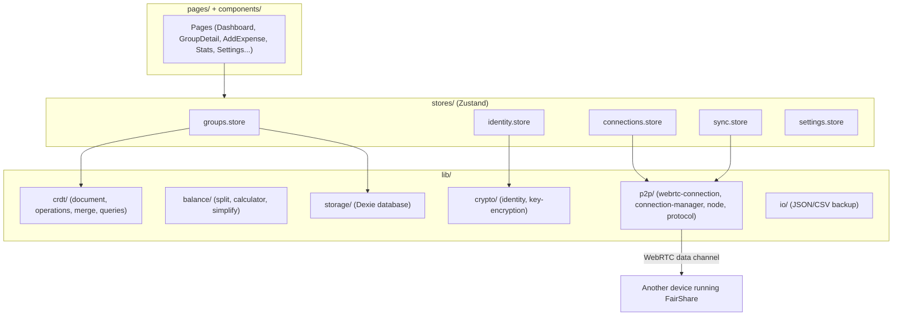

# FairShare: Architecture & Tech Stack

How the app is put together, for anyone contributing code. For a feature-level walkthrough see
the [User Guide](USER_GUIDE.md).

## Tech Stack

- **React 19 + TypeScript**: UI and app logic
- **Vite 8**: dev server and build
- **Tailwind CSS 4**: styling, small shadcn-style primitives in `components/ui/`
- **Zustand + Immer**: app state (stores), with a strict mutate-through-one-path pattern for
  group data so every change gets schema-checked, persisted and synced consistently
- **Dexie**: IndexedDB wrapper for groups, peers and identity metadata
- **WebRTC (native browser API)**: direct device-to-device data channels, no signaling server
- **Zod**: runtime validation of P2P messages, documents and imported backups
- **Ed25519 (via Web Crypto) + AES-GCM/PBKDF2**: identity keypairs and optional
  passphrase encryption on web; Android Keystore / iOS Keychain for native identity protection
- **Capacitor 8**: wraps the same web app as native Android/iOS apps (`android/`, `ios/` are
  full native projects, not just config)
- **Vitest + Testing Library**: unit/component tests. **Playwright**: e2e tests (`e2e/`)

## High-Level Components

### Data model (`lib/crdt/`)

Each group is a single CRDT-style `GroupDocument`: members, expenses, settlements, custom
categories, and tombstones for deletes. Every mutation goes through `operations.ts`, which
bumps a monotonic version/stamp. Two replicas of a document (yours and a peer's) are reconciled
with last-write-wins field merging in `merge.ts`. That's what makes offline edits on two devices
converge correctly once they reconnect, no need for a server to arbitrate

### Balances (`lib/balance/`)

Pure functions, no state: `split.ts` turns one expense + split type into per-member amounts,
`calculator.ts` turns a document's expenses/settlements into net balances per member pair, and
`simplify.ts` reduces those pairwise debts to a minimal set of settling transactions.

### Identity & crypto (`lib/crypto/`)

Every device generates an exportable Ed25519 keypair on first launch; the public key forms the
`peerId` used for member references and message signing. Web storage supports optional
passphrase encryption (PBKDF2 + AES-GCM, the existing `enc1:` format).

`lib/storage/identity-protection.ts` handles native storage through the local
`IdentityProtection` Capacitor plugin. Android registers it in `MainActivity`; iOS registers
it beside KeepAlive in `AppDelegate.swift`.

- Android generates a separate AES-256-GCM wrapping key in Android Keystore for each saved
  identity reference. The wrapping key is nonexportable; the Ed25519 identity key is not.
  IndexedDB holds a `native1:android:` envelope with the wrapping-key ID, random IV and
  ciphertext/tag. The peer ID is authenticated as AAD. Reads never generate a missing key.
  User authentication is disabled, with no biometric or per-read screen-unlock requirement.
  Hardware backing depends on the device; StrongBox is not required.
- iOS stores the identity key as a generic-password Keychain entry. IndexedDB holds only a
  `native1:ios:` reference. Access uses `kSecAttrAccessibleWhenUnlockedThisDeviceOnly` and
  `kSecAttrSynchronizable = false`, without a biometric access-control flag. This is retrievable
  key storage, not a Secure Enclave signing key. A locked device can reject a read.

Native plaintext migration verifies a write/read round trip before replacing the IndexedDB row.
The same path protects creation and JSON/QR restore on the destination platform. Existing
`enc1:` rows are left alone and still need their passphrase; unlocking or renaming does not
remove that protection. Switching them to device protection requires an explicit Settings
action and the current passphrase. Native protection has no off switch.

New native references do not overwrite old secure entries. Old references are removed only
after the new row commits. A failed database commit leaves the old identity usable; cleanup
failures are logged and can leave unused secure entries, never plaintext fallback. Explicit
reset drops the identity row and pending profile marker before removing its native reference,
so a failed database clear cannot strand a row whose wrapping key has already been deleted.
A native delete error is reported after reset; an unused secure entry may remain.
Interrupted writes can also leave unused secure entries. Keychain entries may survive an iOS
uninstall, but reinstall recovery is not promised without an identity backup.

Unlocked identity keys stay in JS memory for signing. File and QR exports retrieve the native
key again (or use the already unlocked passphrase key) after the existing warning. Backups
remain the same unencrypted JSON/QR format. Group data is not encrypted by this feature.
Device protection does not make copied app storage portable or securely erase old IndexedDB pages.

`native-identity.test.ts` covers the adapter and lifecycle with a mocked native bridge and real
IndexedDB transactions. `identity-file-import.test.tsx` covers warnings, export read failures
and boot recovery. These do not test the OS stores. Device checks still need to cover Keystore
key loss, relaunch after migration, iOS locked-device access, reinstall, and JSON/QR transfers
between native and web. Compile the iOS target in Xcode on macOS as well as testing on a device.

### P2P sync (`lib/p2p/`)

- `webrtc-connection.ts`: one RTCPeerConnection + data channel per peer, chunked/paced sends
  for large payloads, ICE via public STUN servers (no TURN/relay server of our own)
- `connection-manager.ts`: one authenticated session per peer (hello handshake proves the
  claimed peerId), tracks which groups are shared with which peer
- `node.ts`: verifies and dispatches every inbound message, handles sync-requests, group
  announcements and peer introductions (asking an already-connected peer to relay signaling to
  reach a third device)
- `message-protocol.ts` / `signaling-codec.ts`: message framing/signing, and the compact binary
  codec used to keep QR codes for offer/answer exchange small

There's no server anywhere in this path, actually: two devices exchange a WebRTC offer/answer
once (QR code or pasted text), then talk directly. Multiple tabs on the same device sync
instantly via `BroadcastChannel` itself, instead of going through WebRTC.

### Storage (`lib/storage/`)

A single Dexie (IndexedDB) database holds groups, documents, the local identity and known peers.
Native identities keep their wrapped key or Keychain reference there, with the protected key
held by Android Keystore or iOS Keychain as described above. There is no server or analytics storage.

### Native layer (`lib/native/`)

Thin Capacitor plugin wrapper (`keepAlive.ts`) for an Android/iOS "keep syncing in background"
toggle, with a no-op web fallback (`keepAlive.web.ts`), so same store code only runs unchanged
in the browser.

## Where to look next

- Adding a UI feature → `pages/` and `components/`, state lives in `stores/`
- Changing how splits/balances are computed → `lib/balance/`
- Changing the sync protocol or document shape → `lib/crdt/` and `lib/p2p/`